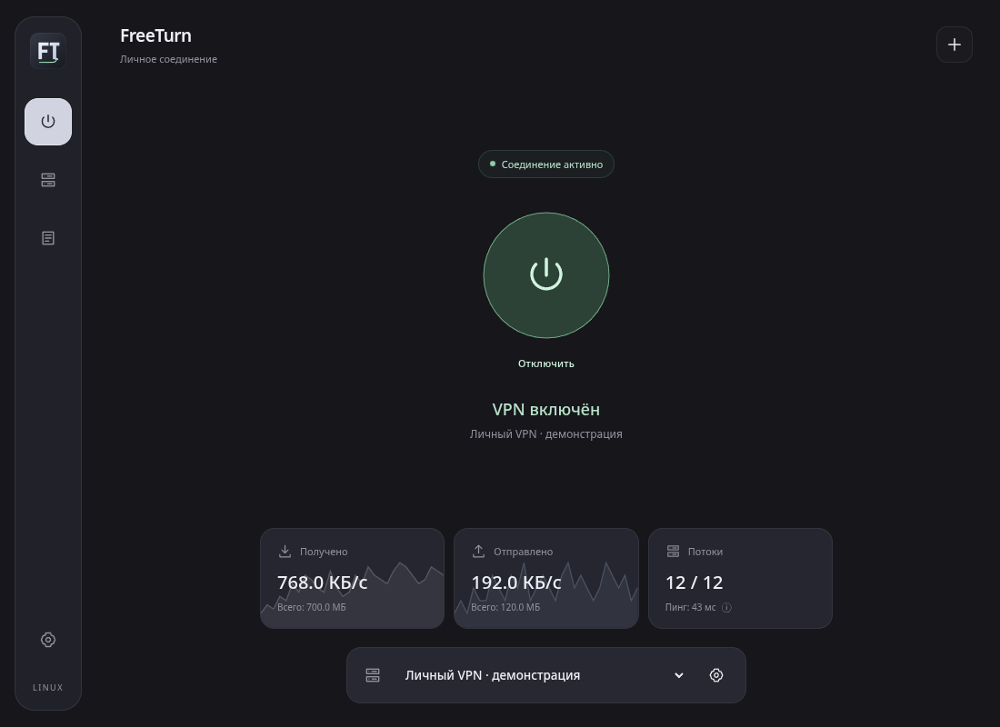
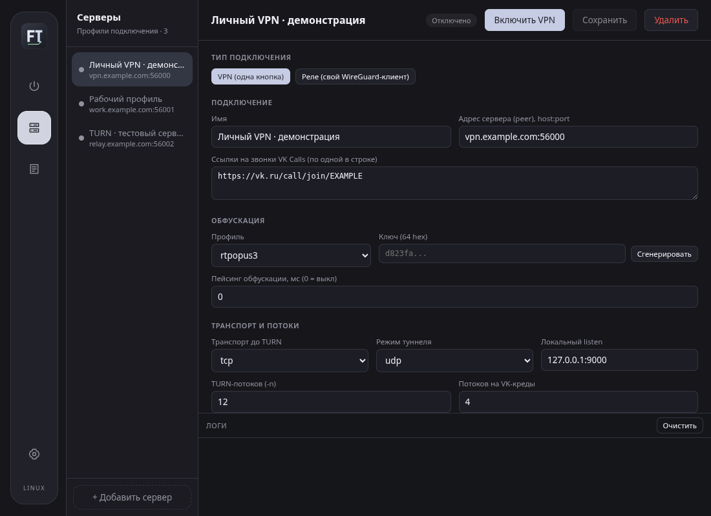
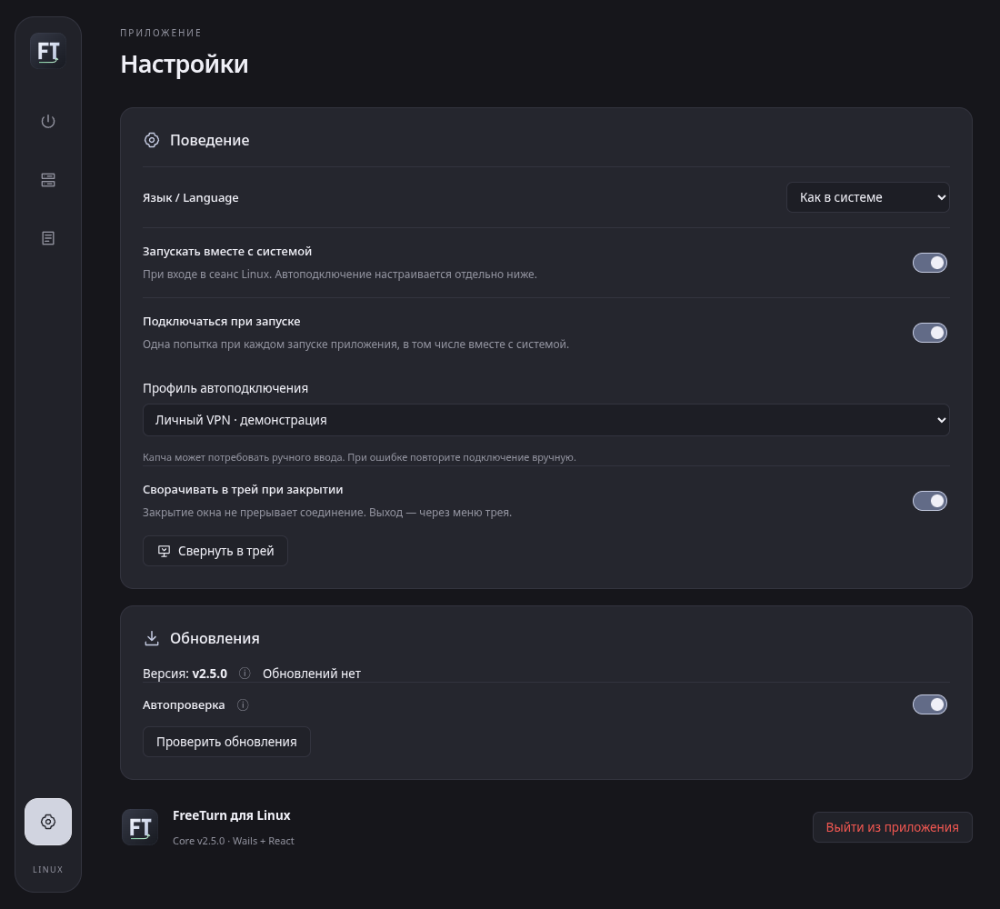

# FreeTurn for Linux

Графический клиент [free-turn-proxy](https://github.com/purkalolka/free-turn-proxy) для Linux на Go, Wails 2 и React. Клиент поддерживает реле для внешнего WireGuard/AmneziaWG и встроенный VPN одной кнопкой.

## Интерфейс

Скриншоты интерфейса на демонстрационных данных. Адрес сервера, скорости, пинг и состояние подключения на этих снимках — тестовые, без реального VPN-подключения и пользовательских ключей.

### Подключение и графики трафика



При активном соединении в карточке потоков показывается ICMP-пинг до адреса сервера, с обновлением примерно раз в 5 секунд. Это не задержка всего VPN-туннеля: используется текущая системная маршрутизация. Измерение запускается без sudo; нужна доступная утилита `ping` (`iputils-ping` в Debian/Ubuntu, `iputils` в Arch). Если сервер блокирует ICMP или измерение недоступно, показано «—». При отключении и смене профиля старое значение сбрасывается.

### Профили серверов



<details>
<summary>Настройки: язык интерфейса, поведение и обновления</summary>



</details>

## Поддерживаемые системы

- Ubuntu 22.04+ и Debian 12+ с WebKit2GTK 4.1.
- Arch Linux и совместимые дистрибутивы с WebKit2GTK 4.1.

Готовый архив релиза содержит клиент `freeturn-desktop`, системный компонент `freeturn-vpn-helper`, консольные `client` и `server`, установщик `install-desktop.sh` и деинсталлятор `uninstall-desktop.sh`. После распаковки выполните `sh ./install-desktop.sh` от обычного пользователя. Установщик копирует клиент, по умолчанию настраивает системный VPN-helper с подтверждением администратора и спрашивает, добавить ли ярлык на рабочий стол (по умолчанию — нет). При отказе или ошибке авторизации клиент остаётся установлен, но для VPN потребуется пароль; установщик сообщает о неполной настройке и возвращает ненулевой код. Его можно запустить повторно.

Копирование клиента не требует `sudo`: стабильная копия помещается в `~/.local/share/FreeTurnDesktop/`, а ярлык — в `~/.local/share/applications/freeturn.desktop`. Учитывается `XDG_DATA_HOME`. Повторная установка обновляет клиент и helper. Зависимости GTK/WebKit и инструменты VPN необходимо установить отдельно. Низкоуровневая команда `./freeturn-desktop --install-desktop` копирует только пользовательские файлы, без вопросов и настройки системного helper (также используется процессом обновления).

### Автозапуск и автоподключение

В **Настройки → Поведение** независимо включаются **Запускать вместе с системой** (при входе в сеанс Linux) и **Подключаться при запуске**. Для автоподключения выберите сохранённый профиль: приложение делает одну попытку при каждом запуске, включая обычный запуск вручную. По умолчанию автоподключение выключено. Изменение настройки не запускает подключение немедленно.

Для VPN без запроса пароля заранее установите системный VPN-helper. При необходимости капчи потребуется ручной ввод. Если сеть ещё недоступна или профиль удалён, автоматических повторов нет: подключитесь вручную или выберите другой профиль в настройках. Автоподключение не является kill switch и не блокирует трафик до установления VPN.

### Иконка и ярлык на рабочем столе

У клиента собственная иконка FreeTurn: она используется в меню приложений, доке, окне и трее. Установка размещает SVG и PNG в пользовательской теме `~/.local/share/icons/hicolor/` (с учётом `XDG_DATA_HOME`). Запускной файл и GTK используют одинаковый идентификатор `freeturn`, чтобы окно корректно группировалось в доке.

Чтобы добавить ярлык на рабочий стол, ответьте «да» в установщике (или выполните `./freeturn-desktop --create-desktop-shortcut`). Учитывается локализованный `XDG_DESKTOP_DIR` из `user-dirs.dirs`, в том числе «Рабочий стол». Ярлык указывает на установленную копию, а не на временный каталог распакованного архива. Если окружение потребует подтверждения, выберите **Разрешить запуск**. Чужой существующий `freeturn.desktop` не перезаписывается.

Если GNOME не отображает значки рабочего стола, потребуется расширение **Desktop Icons NG (DING)**. Ярлык в меню приложений работает без него.

Альтернатива из каталога приложения (без `sudo`):

```sh
./freeturn-desktop --create-desktop-shortcut
```

Для работы окна нужны GTK3 и WebKit2GTK 4.1. Уведомление о капче отправляется через Freedesktop Notifications: на поддерживаемых рабочих столах нажатие на уведомление или кнопку **Открыть в браузере** открывает актуальную проверку в браузере по умолчанию. Само появление уведомления браузер не запускает; закрытие тоже. Если сервер уведомлений не поддерживает действия, используется обычное уведомление через `notify-send` (`libnotify-bin` в Debian/Ubuntu, `libnotify` в Arch), а проверку можно открыть кнопкой в приложении. Старое уведомление после завершения/отмены проверки или переключения подключения не открывает устаревшую ссылку.

При нескольких VK-ссылках капча для части потоков не выключает уже работающее соединение. Пока есть подключённые потоки, сохраняются «VPN включён» и показания трафика, а основная кнопка становится жёлтой. Проверка открывается отдельной кнопкой в жёлтой плашке, доступной на любом экране. После решения капчи плашка исчезает, кнопка снова зелёная. При отсутствии рабочих потоков показывается ожидание проверки.

В режиме VPN нужны `/dev/net/tun`, `ip` из `iproute2`, `pkexec` с работающим Polkit-агентом и `systemd-resolved` для настройки DNS из WireGuard-конфига. Приложение работает от обычного пользователя. Установщик настраивает системный helper для подключений без повторных запросов пароля. Если настройка не выполнена, каждое подключение запускает привилегированный процесс через Polkit.

### Зависимости для запуска

Ubuntu/Debian:

```sh
sudo apt install libgtk-3-0 libwebkit2gtk-4.1-0 iproute2 polkitd systemd-resolved libnotify-bin
```

Arch:

```sh
sudo pacman -S gtk3 webkit2gtk-4.1 iproute2 polkit systemd libnotify
```

Проверьте, что служба `systemd-resolved` работает, если в конфиге WireGuard заданы DNS-серверы. На дистрибутивах с другим DNS-менеджером режим реле работает без этого требования; встроенный VPN сообщит об ошибке настройки DNS и вернёт сетевые маршруты.

## Подключение

1. Добавьте сервер по ссылке `freeturn://` или настройте свой VPS через мастер в приложении.
2. Если у профиля есть WireGuard-конфиг, выберите «VPN (одна кнопка)» и нажмите «Включить VPN». Без установленного системного helper Polkit запросит права на настройку сети.
3. В режиме «Реле» запустите подключение в FreeTurn и направьте внешний WireGuard/AmneziaWG-клиент на указанный локальный порт.

Встроенный VPN запускает реле на обычном интернет-соединении и добавляет маршруты через TUN только после установки соединения. При отключении и при неожиданном завершении приложения привилегированный процесс снимает маршруты и DNS с созданного интерфейса.

### VPN без пароля при каждом подключении

1. Запустите `sh ./install-desktop.sh` из распакованного архива. Настройка VPN-helper включена по умолчанию.
2. Один раз подтвердите установку паролем администратора. Рядом с приложением должен находиться `freeturn-vpn-helper` из того же архива релиза. Обычная пользовательская установка копирует оба файла вместе.
3. Следующие подключения используют системный компонент без `pkexec` и запросов пароля. Установка/обновление самого системного компонента по-прежнему требует подтверждения администратора.

Установка добавляет root-owned `/usr/local/libexec/freeturn-vpn-helper` и пользовательские units `/etc/systemd/system/freeturn-vpn-<UID>.socket` и `freeturn-vpn-<UID>@.service`. Socket activation запускает отдельный процесс на время подключения. Сокет `/run/freeturn-vpn/<UID>.sock` имеет режим `0600`; helper дополнительно проверяет UID клиента через `SO_PEERCRED`. Доступ предоставляется только выбранной учётной записи. Сервис ограничен сетевыми capabilities, не имеет доступа к домашним каталогам и не разрешает запись в системные каталоги. Пароли не сохраняются, GUI не получает root, `sudoers` и правила Polkit не ослабляются.

Режим требует systemd. Если компонент не установлен или его сокет отключён, используется прежний вариант с Polkit. Деинсталлятор отзывает доступ с подтверждением администратора; для отдельного отзыва используйте команду ниже. Общий root-owned бинарник остаётся на диске для других пользователей; после удаления доступа он больше не предоставляет этой учётной записи беспарольный запуск.

Альтернатива для терминала (из каталога распакованного релиза):

```sh
sudo ./freeturn-desktop --install-vpn-service "$(pwd)/freeturn-vpn-helper" "$(id -u)"
# Отозвать доступ этой учётной записи:
sudo ./freeturn-desktop --remove-vpn-service "$(id -u)"
```

## Списки маршрутизации VPN

Откройте **Серверы → профиль VPN → Списки маршрутизации VPN**. Добавьте именованный список, выберите его режим и включите переключатель **Использовать список**:

- **Белый** — через VPN направляется объединение адресов включённых белых списков; остальное идёт напрямую.
- **Чёрный** — перечисленные адреса идут напрямую, а не блокируются. Чёрные списки исключаются из белых. Если ни один белый список не включён, исходным набором служат `AllowedIPs` конфигурации WireGuard.

На профиль доступно до 16 списков и 256 записей. Записи — по одной в строке: точный домен (`example.com`), IPv4/IPv6 или CIDR-подсеть (`198.51.100.0/24`). Поддерживаются IDN-домены; пустые строки и строки с `#` в начале игнорируются. URL, порты, пути и маски `*.example.com` не принимаются. Поддомены нужно добавлять отдельно. Сохраните профиль и переподключитесь; редактирование списков активного профиля заблокировано. Настройки сохраняются с профилем, но не включаются в `freeturn://`-ссылку.

**Ограничения доменов:** это снимок IP через системный DNS перед подключением, не DNS-прокси и не фильтрация HTTPS. При переподключении адреса обновляются. Меняющиеся CDN-адреса, общий IP нескольких сайтов, поддомены и собственный DNS/DoH браузера могут не соответствовать снимку. DNS-запросы до подключения не защищаются будущим VPN. Для точной маршрутизации используйте IP/подсети; функция не является блокировщиком или защитой от утечек.

Правила ограничены исходными `AllowedIPs`: криптографическая конфигурация WireGuard не расширяется. Например, при `AllowedIPs = 0.0.0.0/0` маршрутизируется только IPv4; IPv6 остаётся за пределами такого туннеля, в том числе для доменных правил. DNS-серверы профиля в пределах `AllowedIPs` сохраняют VPN-маршруты как служебное исключение, даже если указаны в чёрном списке. Адреса VPS/SSH имеют приоритет и сохраняют прямой путь. Ошибка DNS, пустой включённый белый список, отсутствие подходящих VPN-адресов или чрезмерное число маршрутов прерывают новое подключение до отключения предыдущего.

Списки работают только для **встроенного VPN**. Для режима реле маршруты задаются в отдельном WireGuard-клиенте; эквивалентная команда CLI списки не применяет. На Linux используются прежние ограниченные операции helper и удаление созданных маршрутов при отключении; новый формат запросов и дополнительные привилегии не требуются.

## Отрисовка интерфейса

Интерфейс использует статичные однотонные фоны: без размытия, фоновых градиентов, свечения, теней и декоративных анимаций страниц/графиков. Цветовые состояния и фокус клавиатуры сохранены; анимируется только индикатор выполняющегося подключения. Это снижает затраты на отрисовку, но само по себе не исправляет ошибки WebKit/Wayland или видеодрайвера.

Выбор рендерера из настроек убран: WebKit автоматически разрешено использовать GPU с учётом поддержки драйвером. Старое поле `renderingMode` в `desktop.json` больше не влияет на запуск и удаляется при следующем сохранении настроек.

Для NVIDIA в сеансе Wayland при заданном `DISPLAY` автоматически выбирается XWayland (`GDK_BACKEND=x11`) и совместимая передача кадров через общую память (`WEBKIT_DMABUF_RENDERER_FORCE_SHM=1`). Это оставляет ускоренный рендерер доступным, но добавляет копирование кадров. Если XWayland не предоставлен сеансом (`DISPLAY` отсутствует), выбирается безопасная программная отрисовка вместо заведомо проблемного NVIDIA/Wayland-пути. Причина режима совместимости видна в настройках и в выводе терминала. Явно заданные пользователем `GDK_BACKEND` и `WEBKIT_DMABUF_RENDERER_FORCE_SHM` не перезаписываются.

`WEBKIT_DISABLE_DMABUF_RENDERER=1` приложение автоматически **не** выставляет: в современных версиях WebKitGTK это может отключить аппаратный композитинг полностью. Если переменная уже задана пользователем, настройка сохраняется, а интерфейс предупреждает о возможном отключении ускорения. Ни выбранная политика, ни наличие NVIDIA-драйвера не являются измерением фактического GPU-рендеринга; совместимость с конкретной версией драйвера требует проверки на реальной системе.

Для аварийного запуска завершите клиент (включая трей) и запустите его из терминала:

```sh
./freeturn-desktop --software-rendering
```

Этот флаг включает CPU-режим только для текущего запуска. Чтобы вернуть автоматический выбор, перезапустите приложение без флага. Настройки сеанса, видеодрайвера и VPN-профили не меняются.

## Трей и автозапуск

- Иконка трея автоматически становится светлой на тёмной системной теме, а на светлой используется обычный тёмный вариант. Переключение работает без перезапуска через XDG Desktop Portal (`org.freedesktop.appearance/color-scheme`). Если портал недоступен или не задаёт предпочтение, учитывается `GTK_THEME`; иначе используется обычная иконка. Иконки окна, ярлыка и меню приложений не меняются.

- **Настройки → Сворачивать в трей при закрытии**: по умолчанию включено. Закрытие окна скрывает его, не отключая VPN. В меню трея доступны «Открыть FreeTurn» и «Выход». Полный выход отключает VPN и восстанавливает маршруты.
- Трей использует StatusNotifierItem/AppIndicator через пользовательский D-Bus. В GNOME установите расширение **AppIndicator and KStatusNotifierItem Support**. Если трей недоступен, окно не скрывается: закрытие завершает приложение и VPN.
- **Настройки → Запускать вместе с системой**: создаёт `~/.config/autostart/freeturn.desktop` (учитывается `XDG_CONFIG_HOME`) и устанавливает стабильную копию клиента. Это запуск при входе в графический сеанс. Для автоматического подключения отдельно включите **Подключаться при запуске** и выберите профиль. При установленном системном helper подключение не требует пароля.
- При автозапуске окно скрывается, только если трей доступен. Повторный запуск из меню показывает уже работающее окно.
- Для удаления завершите приложение через **Выйти из приложения** и выполните `sh ./uninstall-desktop.sh` из распакованного архива. После подтверждения деинсталлятор отзывает доступ к системному helper (с авторизацией администратора), удаляет пользовательские бинарники, иконки и только управляемые FreeTurn ярлыки меню/рабочего стола/автозапуска. При ошибке отзыва доступа пользовательские файлы не удаляются. Профили в `~/.config/FreeTurnDesktop/`, настройки, неизвестные файлы и резервные копии обновлений сохраняются; их можно удалить отдельно вручную. Общий системный бинарник helper и сам распакованный архив не удаляются.

Окно открывается в минимальном поддерживаемом размере **900 × 600**; его можно растянуть. Главный экран содержит кнопку подключения, выбор сервера и текущую скорость трафика. Во время подключения повторное нажатие основной кнопки отменяет попытку — дополнительная кнопка не появляется и не сдвигает интерфейс. Мягкий волнистый контур вращается с бегущим штрихом; центральный индикатор в стиле Material Expressive начинает с овала и плавно меняет лепестковые формы. После подключения контур превращается в круг с небольшим пружинным отскоком, а индикатор сменяется значком питания для отключения. Системная настройка уменьшения движения отключает анимацию. Полупрозрачные графики в карточках приёма и отправки показывают последние 60 замеров, отдельно для каждого направления. Редактирование профилей и управление VPS находятся в разделе **Серверы**, последние 500 записей — в **Журнале**.

## Обновления приложения

В **Настройки → Обновления** можно проверить стабильные релизы и скачать архив для архитектуры текущего клиента. Репозиторий задаётся **при сборке**, а не в исходниках: workflows передают `${{ github.repository }}`, поэтому каждый форк проверяет собственные Releases. Тестовые артефакты Actions и prerelease не предлагаются.

Автопроверка по умолчанию включена: через 10 секунд после запуска, затем каждые 6 часов, пока приложение работает (в том числе в трее). Её можно выключить; ручная проверка остаётся доступной. Передаются только обычные запросы к публичному GitHub API, без VPN-профилей, ключей и токенов пользователя. Недоступность GitHub или ограничение частоты запросов не мешают VPN. При новой версии в интерфейсе появляется уведомление. Его можно закрыть крестиком: эта версия больше не напоминает о себе, в том числе после перезапуска, но остаётся доступной в настройках. Следующая версия или другой репозиторий снова вызывают уведомление.

Подсказки ⓘ в настройках появляются во всплывающем окошке при наведении или фокусе с клавиатуры, не сдвигая интерфейс. Курсор можно перевести на текст подсказки. Закрытие — уход курсора, Escape или нажатие снаружи; на сенсорном экране доступно открытие нажатием.

**Настройки → Поведение → Язык / Language**: компактный выбор «Как в системе / English / Русский». По умолчанию используется системная локаль Linux (`LC_ALL`, `LC_MESSAGES`, `LANG`); для неподдерживаемого языка — английский. Ручной выбор сохраняется и применяется сразу, без перезапуска или переподключения. Имена профилей, ключи, конфиги и исходные диагностические сообщения не переводятся. Общие JSON-словари и helper позволяют добавлять языки без правок компонентов — см. [docs/localization.md](docs/localization.md).

Скачивание запускается **только по кнопке**, место сохранения выбирается в диалоге. Клиент требует архив `FreeTurn-Linux-<архитектура>-<тег>.tar.gz` и `checksums.txt` из того же релиза. Размер и SHA-256 проверяются до сохранения итогового файла; при ошибке временный файл удаляется. SHA-256 защищает от повреждения скачивания, но не является независимой цифровой подписью издателя.

Кнопка **Скачать и установить** открывает отдельное подтверждение с версией, местом установки и предупреждением об отключении VPN. После согласия клиент скачивает и проверяет архив, безопасно извлекает только два ELF-бинарника нужной архитектуры, завершает VPN и приложение. Во время загрузки показываются процент, скачанный объём, средняя скорость и примерное оставшееся время. Проверка SHA-256, распаковка и подготовка перезапуска показываются отдельными этапами без выдуманного процента установки. После закрытия окна установка продолжается отдельным процессом, результат виден после перезапуска.

Отдельный пользовательский процесс ждёт завершения старого клиента, сохраняет предыдущую пару, заменяет файлы в `~/.local/share/FreeTurnDesktop/` (с учётом `XDG_DATA_HOME`), обновляет иконки/ярлык и запускает новую копию. Каждая замена файла атомарная; профили и настройки не меняются. Ни `sudo`, ни права администратора для этого не используются.

Новая копия должна подтвердить запуск интерфейса за 45 секунд. При ошибке установки или запуска восстанавливается предыдущая пара и запускается старый клиент; ошибка видна в **Настройки → Обновления**. Сообщение об успешной установке не остаётся в обычных настройках. Резервная копия лежит в `.freeturn-update-*/previous/` внутри каталога установки; эти каталоги не удаляются автоматически. Для ручного отката завершите клиент и выполните `./freeturn-desktop --install-desktop` из нужной резервной папки. Логи процесса установки хранятся в той же `.freeturn-update-*` папке. Защита от внезапного отключения питания между заменой двух файлов не гарантируется.

**Системный** `/usr/local/libexec/freeturn-vpn-helper` не заменяется автоматическим обновлением клиента: для его обновления запустите установщик нового архива с подтверждением администратора. Автопроверка ничего не скачивает и не устанавливает без согласия. Старая версия без протокола подтверждения запуска не устанавливается автоматически: для неё можно воспользоваться отдельной кнопкой **Скачать**, распаковать архив и установить вручную. Релизы без готового архива или SHA-256 скачать через клиент нельзя.

Версия GUI встраивается в релизную сборку из тега независимо от версии VPN-ядра. У локальных/тестовых сборок без тега показано `dev`: точное сравнение версий невозможно, но стабильный релиз можно скачать. Для локальной сборки явно укажите источник и, при необходимости, версию:

```sh
UPDATE_REPOSITORY=owner/repository VERSION=v2.1.0 sh packaging/linux/build-desktop.sh
```

Без `UPDATE_REPOSITORY` локальная сборка не обращается к серверу обновлений. Для ручного `wails build` эквивалент — добавить `-X main.updateRepository=owner/repository -X main.desktopVersion=v2.1.0` к `-ldflags`.

## Сборка

### Автосборка в GitHub

Workflow **Build Linux desktop** запускается после каждого push в ветку, для pull request или вручную через **Actions → Build Linux desktop → Run workflow**. Он собирает Linux amd64, выполняет проверки и сохраняет результат на 14 дней: откройте успешный запуск → **Artifacts → FreeTurn-Linux-amd64**. Внутри — архив `FreeTurn-Linux-amd64.tar.gz` и файл SHA-256. Архив содержит приложение, VPN-helper, установщик, ярлык, иконку и документацию; консольные `client` и `server` остаются в полном релизе.

Это тестовые сборки текущей ветки, не автоматическая публикация релиза. Релизный workflow по тегам `v*.*.*` сохранён отдельно. В форке при необходимости включите GitHub Actions во вкладке **Actions**.

### Одной командой локально

```sh
sh packaging/linux/build-desktop.sh
```

Скрипт проверяет инструменты и GTK/WebKit, устанавливает Wails CLI закреплённой версии, выполняет `npm ci`, собирает приложение с helper и создаёт архив в `dist/` с SHA-256. Запускается из любого каталога, без `sudo`; системные зависимости нужно установить заранее. Исходные профили и установленная копия приложения не меняются.

### Зависимости и ручная сборка

Требуются Go 1.26+, Node.js 22.18+, npm, C-компилятор, заголовки GTK3 и WebKit2GTK 4.1. На Ubuntu/Debian установите `libgtk-3-dev libwebkit2gtk-4.1-dev`; на Arch используйте `gtk3 webkit2gtk-4.1 base-devel`.

```sh
go install github.com/wailsapp/wails/v2/cmd/wails@v2.16.0
npm --prefix desktop/frontend ci
cd desktop
wails build -tags webkit2_41 -ldflags "-checklinkname=0 -s -w" -trimpath
```

В `desktop/build/bin/` появятся **оба** файла: `freeturn-desktop` и `freeturn-vpn-helper`. Helper автоматически собирается Linux post-build hook после сборки приложения, для той же архитектуры. Переносите оба файла вместе; для обновления пользовательской копии выполните `./freeturn-desktop --install-desktop` из каталога сборки. Для разработки используйте `wails dev -tags webkit2_41`. Команда `task build` собирает только консольные `client` и `server` в `dist/`.

Если приложение уже собрано, недостающий helper можно собрать отдельно из корня репозитория:

```sh
sh packaging/linux/build-vpn-helper.sh
```

Проверки обновления состояния и статистики интерфейса: `npm --prefix desktop/frontend test`.

Исходник иконки — `desktop/assets/icon.svg`; PNG-версии и favicon уже включены в репозиторий. После изменения SVG их можно обновить командой `sh packaging/linux/render-icons.sh` (нужен `rsvg-convert` из `librsvg2-bin` / `librsvg`).

Go-модуль намеренно сохраняет имя `github.com/samosvalishe/free-turn-proxy`, чтобы не менять импорты ядра и существующие инструменты. Источник Linux-клиента отделён от [Windows-клиента](https://github.com/purkalolka/free-turn-windows); серверная часть и протокол совместимы.
